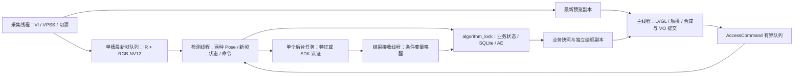

# ky50_ui 开发指南

更新日期：2026-11-14，北京时间。适用于 CV1842HP / KY50、480×854 ST7102、双 GC2083 和当前 CV184X SDK。本文是主应用后续开发的入口；硬件排查过程保留在 [UI 与预览历史开发记录](../../../../Doc/KY50_触控UI与RGB预览开发记录及扩展指南.md)。

## 1. 当前工作状态

**人脸集成阶段已完成，后续以 RGB 人脸 + IR 掌静脉双模态版本继续增加功能。** 已完成应用接入、注册/识别业务路径、独立 UUID、双框绘制、性能优化、参数页面及实时配置，并完成构建、自动化回归、板端 SDK 验证和现场交互确认。工程接入完成与量产准确率验收分别记录。

| 项目 | 当前状态与验证边界 |
| --- | --- |
| 人脸与掌静脉输入 | 人脸固定来自 RGB pipe1；掌静脉固定来自 IR pipe0。两种检测每轮分别执行，预览选择不改变算法模态 |
| 双框与业务优先级 | 同时检测、同时绘制；原始手掌检测命中时，只进行掌静脉特征/识别业务；用户确认“现在跟随可以接受，双框正常” |
| 用户业务 | 新建人员、两种模态注册、识别记录、取消、删除、异常恢复已接入；主机业务和真实 LVGL 交互回归通过。人脸相机实测已检出；真实人员注册/认证准确率尚需专项验收 |
| UUID | 人脸和掌静脉各自使用 SDK 空闲 ID 接口，0～99，允许跨模态同号；上层人员关系由 SQLite 凭证绑定决定 |
| 高级设置 | 六页参数设置，包含掌静脉三项、人脸七个独立项、独立离场帧数、继电器时长，以及共用匹配确认次数、成功冷却秒数和人脸强活体开关；离场/人脸参数用户确认“页面、触摸和保存均正常” |
| 配置生效 | 点击保存后在算法线程立即应用，不需重启；持久化只负责后续启动恢复。真实 SDK 的七项人脸 setter 和独立离场配置已在板端隔离测试通过 |
| 离场 | 两种模态默认均为5次连续未检测到，各自可设1～100；最近一次现场验收时用户保存为掌静脉3、人脸3，升级不得覆盖该选择 |
| 性能与识别响应 | 后台特征/认证与检测分开；上一异步版现场确认“等待明显缩短，跟随正常”；本轮硬件加速后无人场景预览实测约24～25 fps。上一版常见两次有效人脸匹配间隔531～596 ms，当时另有3秒事件间隔；该成功限制已改为共用可配置参数，默认0秒，历史间隔不能当作当前总识别耗时保证 |
| 掌静脉曝光优化 | 已取消曝光固定等待与ISP稳定标志阻塞，修复异步成功曝光保存，并合并后台特征/匹配；成功冷却可设0～60秒、默认0；共用匹配确认可设1～10次、默认1；保留同次停留去重；验证见掌静脉专题 |
| 成功显示与继电器 | 识别页绿色表示业务确认成功，与结果文字同帧提交；两种模态确认成功均触发内核定时继电器，默认5秒，可设1～60秒；本轮验证见下方新记录 |
| 发布方式 | 本轮通过 SSH + NFS 发布，运行资产复制到板端 `/tmp`；本轮没有刷写固件或更新开机服务 |

仍需按新需求单独完成：真实人员注册/识别、误识/拒识及活体效果评估，代表性光照/姿态/距离下的测试，长时间运行、频繁切源、断电恢复及最终固件冷启动验收。已有 ISP `WDMA buffer full` 告警尚未单独闭环，不能把画面正常写成内核告警已解决。

指纹、卡、密码入口及若干菜单仍是预留；额外门禁授权策略（时段/权限组等）、完整考勤规则、数据导出/同步、Wi-Fi、真实门铃不随人脸接入自动完成。本轮已按需求接入两种识别成功后的自动继电器脉冲；工厂测试继续固定5秒，二者共用设备控制器。DVP、音频的硬件条件和验收范围查历史专题，不由本次人脸验收覆盖。

2026-11-13 新增工厂灯控：现有两个补光灯占位按钮已接通独立 GPIO 开关。白光 `LED_PWM` → GPIOA19，红外 `ILED-PWM` → GPIOA8；均为高开低关、mux 3，不使用 PWM。按用户最新要求，应用每次启动默认红外常亮、白光关闭；之后允许手动切换，切页保持状态，不持久化。退出时两路 GPIO 拉低。后端为 `factory.c` 与 `kernel/ky50_lights.c`，默认值由 `main.c` 在灯控初始化成功后、采集线程启动前应用。此次构建及上板验收范围独立记录在 [灯控验证记录](evidence/lights/VALIDATION.md)，不沿用此前其他功能的板端验收结论。

首版灯控包已通过 NFS 在 `192.168.31.83` 启动，GPIO 寄存器与输入回读开关检查通过，用户确认白光正常亮灭。红外关闭后仍微亮，物理关断未通过；原理图存在 `5V → R52(20Ω) → D6 → LED+` 旁路，用户已确认 R52/D6 焊接，EN 电压未测、支路隔离未做，按用户最新要求暂不处理。不能将 GPIO 低电平等同于红外灯已经熄灭。首版日志 `/tmp/ky50-lights.log`；启动默认值更新后的发布和验证结果见 [历史开发记录第15节](../../../../Doc/KY50_触控UI与RGB预览开发记录及扩展指南.md#15-工厂灯控与应用启动默认状态2026-11-13)。本轮保留离场参数3/3，未更新固件或自启。

主要证据：

- [成功显示同步、硬件旋转/CSC及继电器验证](evidence/success-relay/VALIDATION.md)。
- [人脸强活体与开销验证](evidence/ir-strong/VALIDATION.md)。
- [掌静脉曝光与异步衔接验证](evidence/palm-ae/VALIDATION.md)。
- [异步识别、延迟与本轮现场验证](evidence/async-recognition/VALIDATION.md)。
- [人脸性能与双框现场验证](evidence/face-performance/VALIDATION.md)。
- [参数、独立离场配置与现场保存验证](evidence/face-settings/VALIDATION.md)。
- [用户数据库和恢复协议](USER_DATABASE.md)、[SDK 集成说明](../../../libpva_face/SDK_INTEGRATION_zh.md)。

2026-11-14追加：掌静脉 `PVA_PALM_SECOND_KEYPOINT_ENABLE` 默认关闭，跳过特征阶段的大图旋转和二次关键点检测，保留首次检测及小ROI处理。两种宏构建通过，当前板上为0；用户确认“掌识别速度明显变快，倾斜也能识别成功，框跟随正常”。10次成功任务38～93 ms，成功任务到显示中位243 ms。人脸失败分数表明小幅降低质量/IR阈值收益有限，本轮未改阈值。交接和SQLite仍有开销，独立临时库证明WAL/FULL值得后续实施；正式数据库仍为DELETE/FULL。详见[二次关键点、失败阈值与后续方案](evidence/image-resample/FIRST_KEYPOINT.md)。

2026-11-14追加人脸输入优化：默认NV12直接生成两张112×112对齐图，三种插值逐像素回归通过；保留reference整图转换和vpss硬件颜色后端做同程序对照。实景准备阶段129→约73 ms，但成功任务到显示仅500→475/481 ms，用户反馈三种都正常、没有明显变快。当前选择direct，RGB活体关闭、IR强活体开启，用户保存的活体阈值0.20保持不变。实现、后端生命周期与完整对照见[人脸输入优化](evidence/image-resample/FACE_INPUT.md)。

### RGB/IR人脸位置校准（2026-11-14）

工厂测试新增“人脸双摄对齐”：采集120组有效配对，用两路五点关键点拟合映射并以框验证，成功后自动保存、立即启用。
已校准的人脸认证通过RGB框直接计算IR裁剪位置，调用`pvaFaceLiveIrRegion`，省掉IR重复检测。
映射人脸框、关键点越界直接不合格，不修补映射框、不回退检测；IR按映射人脸矩形1.0倍裁剪，不向外扩展，缩放时保持比例并填充模型画布；掌静脉路径不变。

参数独立存储在`/mnt/system/ky50-data/face_ir_calibration.conf`。首台实机验证后的参数纳入
`assets/face_ir_calibration.conf`随应用发布，同一摄像头装配的后续设备直接复用，无须逐台校准；本机重新校准可覆盖默认值。
与`pvaConf.json`和`app.conf`分开。120帧校准、配对/误差门槛、加载规则及本轮验证见
[人脸RGB/IR校准记录](evidence/image-resample/FACE_IR_CALIBRATION.md)。本轮已采到120组实机参数并纳入assets，RMS为4.847像素，后续同装配设备直接复用。
最终1.0倍版本已上板，用户确认“成功提示速度及框跟随正常，这版体验比较好。认为这个优化成功”。
6次成功样本中位：IR45ms、后台170ms、成功任务至显示324ms；旧直接NV12版本分别183/305/475ms。
本轮已明显提速，但250ms总响应目标尚未达到；保留现有同步考勤和结果消费线程，后续另行优化。


## 2. 版本与目录基线

以下是2026-11-14最近一次部署的固定记录，不表示以后每次打开本文时的实时板端状态。重新上板应读取实际进程和配置核对，不能只看目录名或 PID。

| 项目 | 最近部署值 |
| --- | --- |
| 源码 | `SDK/cvi_mpi/sample_app/ky50_ui` |
| SDK 源码 | `SDK/libpva_face` |
| SDK 交付产物 | `SDK/libpva_face/build/cv184x-delivery` |
| 应用实际链接库 | `ky50_ui/pva/lib/libpva.a` |
| NFS 主机发布目录 | `/home/bonoy/NFS_Files/ky50_face_input_compare` |
| 板端发布目录 | `/mnt/data/opt/ky50_face_input_compare` |
| 运行程序 / 日志 | `/tmp/ky50-ui/ky50_ui` / `/tmp/ky50-face-direct-final.log` |
| 正式用户数据目录 | `/mnt/system/ky50-data` |
| ELF SHA-256 | `cfdda1e7827bc094550e84902ebf1e92a2f02ae722710f1dae6bcb8c9c2209a9` |
| 应用 libpva SHA-256 | `752386e4f2b46800bd58ee744a9d400fc44c9206a330e9b0e64dedda9a6fa8c0` |

当前 `cvi_mpi` 工作树中 `sample_app/ky50_ui/` 仍显示为未跟踪目录；不能认为新功能已由 Git 提交保护。继续开发或交接前，确认源码、配置、工具和必要文档的版本管理范围，保留现有未提交修改。历史发布包、`build/` 下的验证日志和源码备份也不要随手用 `make clean` 清掉。

## 3. 从哪里增加代码

| 文件 | 职责 / 扩展位置 |
| --- | --- |
| [main.c](main.c) | 线程启动与退出、预览源切换、帧交接、两种检测调度、结果绘制与统计 |
| [camera_port.c](camera_port.c)、[scale.c](scale.c)、[pixels.c](pixels.c) | VI/ISP、VPSS 缩放、按 stride 读取、旋转、颜色和布局转换 |
| [display_port.c](display_port.c) | LCD/VO 资源及最终显示提交；沿用已验证面板时序 |
| [biometric_worker.h](biometric_worker.h)、[biometric_worker.c](biometric_worker.c) | 单任务后台特征/认证、独占输入、结果交接与取消代次 |
| [palm_queue.h](palm_queue.h)、[palm_queue.c](palm_queue.c) | 有界最新帧队列；名字虽为 palm，已同时携带 IR 和人脸 NV12 |
| [handpose_bridge.cpp](handpose_bridge.cpp) | C/C++ 边界、PVA 初始化、公开 API 适配、两种 backend、SDK 参数应用 |
| [access.h](access.h)、[access.c](access.c) | 命令队列与快照、注册/识别状态机、优先级、离场、参数保存流程 |
| [access_store.h](access_store.h)、[access_store.c](access_store.c) | 人员和凭证关系、事务、恢复待办、考勤审计、SDK 参数持久化 |
| [face_ir_calibration.h](face_ir_calibration.h)、[face_ir_calibration.c](face_ir_calibration.c) | 120帧双摄配对、仿射拟合、独立校准文件与严格映射边界；通用默认值在assets，重新校准在主应用数据目录 |
| [app_config.h](app_config.h)、[app_config.c](app_config.c) | 主应用配置 `app.conf`；离场帧数、继电器时长、共用匹配确认和成功冷却；v1/v2/v3保留原值升级到v4 |
| [hand_overlay.h](hand_overlay.h)、[hand_overlay.c](hand_overlay.c) | 人脸/手掌坐标映射、绘制副本、显示防抖 |
| [ui.h](ui.h)、[ui.c](ui.c)、[user_ui.c](user_ui.c) | 页面、触摸回调、参数草稿、异步操作状态和人员流程 |
| [settings.c](settings.c)、[ir_exposure.c](ir_exposure.c)、[factory.c](factory.c) | 预览选择持久化、IR AE 反馈、工厂硬件测试；不要与识别策略混为一层 |
| [relay_control.c](relay_control.c)、[kernel/ky50_relay.c](kernel/ky50_relay.c) | UI线程非阻塞发脉冲，内核负责定时关闭、重触发和退出关闭 |
| `tools/`、`evidence/` | 可重现测试工具和分阶段验证结论 |

`UI_PALM_ENROLL` 是既有枚举名，目前两种注册共用该页面，根据 `enrollment_modality` 分支；新增功能不要仅凭名字推断只支持掌静脉。

## 4. 线程、缓冲与生命周期

2026-11-14 结果交接优化：检测、特征/SDK认证和结果接收分离；业务状态、SQLite和ISP回调仍由同一把 `algorithm_lock` 串行保护。历史改造见 [异步识别验证](evidence/async-recognition/VALIDATION.md)，本轮实现与验证见 [结果交接与写库优化](evidence/image-resample/RESULT_LATENCY.md)。此前单算法线程的描述由本节更新取代。



运行期遵守以下所有权。初始化/退出期间，采集线程在算法线程启动前完成 SDK、数据库打开，并在算法线程退出后关闭；不能把这两个阶段误改成并发访问。

1. 主线程独占 LVGL、触摸和 UI 对象。按钮回调只校验、复制参数、入队和显示状态，不做 SDK 推理、数据库扫描、网络等待或文件批量复制。
2. 采集线程独占 VI/VPSS 的获取、释放和切源。算法只能使用应用拥有的帧副本，不能在原 VI/VPSS 帧释放后继续持有其地址。
3. 检测线程在 `algorithm_lock` 外执行两路 Pose；输入为其独占CPU副本。手掌 Pose 返回后先取得锁，发布原始掌优先信息，再解锁执行RGB Pose。每次重新加锁都检查媒体epoch；旧epoch只丢弃，不能提交业务。检测线程负责新帧/离场计数、SDK样本捕获和命令；结果接收线程由 `bio_worker_wait_result` 条件变量立即唤醒，在同一把锁内调用 `access_consume_results`，执行结果校验、注册/认证完成处理、SQLite和AE。两者不能并发改业务状态或操作ISP。后台特征/认证线程只执行SDK计算并返回独占结果，不写SQLite/UI；nice=1，结果接收nice=1，检测nice=3，采集/UI nice=0。
4. `palm_queue` 只有一个待处理帧，消费者取走后独占缓冲。替换旧待处理帧用于降低延迟，不算漏检；不要改成无限队列。`have_ir` / `have_face` 分别表示输入有效性，`epoch` 用于淘汰切源前结果。`face_pair`随同一槽传递RGB/IR原始PTS，不能用取帧完成时间替代；`ir_sample` 随 IR 图像传递采集序号、采集时间、曝光目标和 ISP 稳定标志，不能用消费结果时刻替代。
5. 当前输入采集后超过250 ms会被丢弃并打断连续计数；这是输入过期策略，与500 ms绘框结果超时、后台结果1500 ms有效期不同。新增任务不能长期占用算法线程，使输入不断过期。
6. 切源先清队列、递增 epoch、取消后台结果，再协调媒体资源。退出先由检测线程停止并 join 结果接收线程，再 join 检测线程，`access_close` 取消并 join 特征/认证线程，随后关闭数据库和 SDK，再停止媒体/释放队列；主线程等待采集线程退出后释放 UI、VO、SYS。不要用强杀或热卸载 VO 替代正常停止。
7. 后台只有一个任务槽，无待执行积压。人脸先用 `pvaCaptureFaceSample` 固化当前 NV12、浮点检测与关键点，后台用 `pvaGetFaceSampleFeat`，完成后释放；不能延迟调用旧的 `pvaGetFaceFeat` 并依赖“最近一帧”缓存。手掌复制 Y 图，SDK 对共用检测模型的输入/推理/输出加锁；人脸检测输出与特征输出分开，TPU提交串行，CPU前后处理允许并行。
8. 原始目标消失/输入异常会废弃该模态的在途结果；原始手掌非零（存在或未知）会立即废弃人脸任务。任务无法强行中断 SDK 内部执行，但结果不得用于业务成功提交、注册或更新 UI。有效结果最长保留1500 ms；立即接收还要求最新原始掌观测不超过250 ms，人脸结果另要求最新人脸观测不超过250 ms。页面epoch或尚未处理的配置/用户命令也立即取消结果。业务离场仍按每次有效 Pose 连续未检出计数，绝不等特征完成。
9. 修改参数、取消/删除/开始注册时，先取消旧任务并等待其自然结束；等待期间继续检测，不再提交新任务，随后由状态线程应用命令。保存提示只在真正应用后出现；仍是运行期实时生效。SDK生命周期和参数更改不能与后台操作直接并发。识别页面变化同样取消旧任务。

新增网络同步、U盘导出等耗时任务应使用有界后台任务；若要访问业务数据库，先通过现有所有者取得一致的数据或设计明确的同步协议。线程之间传数据与请求编号，不传 `lv_obj_t *`。用户离页后，旧任务不能操作已经销毁的控件。

### IR 曝光与掌静脉异步衔接（2026-11-13）

按最新现场要求，正常曝光调整不再阻塞认证：没有固定500 ms、没有固定3帧门限，也不要求ISP全局稳定标志置位。后台特征返回SDK质量通过即可继续匹配；SDK过亮/过暗/模糊等拒绝条件仍生效。ISP全局稳定标志随图记录用于诊断，不能作为额外的业务成功门槛。首次入场图像已经合格时，不为恢复历史曝光而改变它。

曝光写操作仍属于检测/业务线程；采集线程读取IR帧元数据。过亮/过暗反馈只使用对应当前曝光目标的新样本，丢弃旧/重复反馈，防止滞后图像驱动连续过调。读取/写入失败的1秒重试、亮度到边界的2秒退避只约束AE调整，不阻塞质量已通过的认证。曝光反馈返回值不得再次加入认证条件。

异步任务携带原图的采集序号、曝光目标和generation。真实成功后校验曝光版本及目标仍一致，再保存成功目标；不要求认证完成时刻等于特征反馈时刻。图像质量与身份匹配通过的结果不因后续AE状态变化而丢弃，但不一致的曝光凭据不能更新保存值。确认离场/切源和再次改曝光使旧曝光凭据失效。保存位置仍为主应用SQLite的`pva.ir_ae_target.v1`，不是pvaConf.json。

`BIO_PALM_RECOGNIZE`在一个后台任务内完成特征和匹配，消费结果后立即尝试提交当前新的IR样本，不重复计入场/离场，也不重复使用同一采集序号。取消异步掌静脉认证原180 ms人为间隔，注册与同步兼容路径保留。两种模态共用`match_confirmations`，1～10次，默认1次；在参数第6页设置。`candidate_count`与`face_candidates`分别累计同一UUID的有效匹配，达到该共用值才提交成功。修改参数会清除尚未完成的累计计数并取消旧后台任务，但不解除成功锁。它属于主应用策略，不是SDK参数。

两种模态共用`success_cooldown_seconds`，0～60秒，默认0秒，参数第6页保存后立即应用。冷却以最近一次真实成功为起点，跨模态共用；失败事件不会重置这个起点。设为0时，每种模态同一次停留只成功一次，达到该模态配置的连续离场帧数后重新进入即可再次认证；设为正数时还须满足成功冷却。修改冷却不解除成功锁，也不改变已经启动的继电器脉冲。未知人员的失败记录节流保留。

回归：`make exposure-test access-test biometric-test queue-test`与`tools/run_async_tests.sh`，覆盖无固定等待/旧曝光反馈/异步保存与恢复/任务取消，以及两种模态在3秒内离场重入、跨模态无冷却、持续停留不重复、共用匹配次数/冷却的默认值、边界及实时修改。板端结果见[evidence/palm-ae/VALIDATION.md](evidence/palm-ae/VALIDATION.md)。

### 人脸强活体（2026-11-13）

参数第6页的“强活体检测”默认开启，仅增强人脸识别，不参与掌静脉和注册。它由独立主应用app.conf的`strong_liveness`控制。2026-11-14改为两个独立开关：“RGB活体检测”只控制RGB特征流程，“强活体检测”只控制IR检查，支持全开、仅RGB、仅IR、全关；不再互相限制或自动关闭另一项。RGB仍经原SDK参数链路保存，IR仍保存在app.conf，不增加混用配置。两者当前共用人脸活体阈值。CV184X SDK初始化时保持共用活体模型可用，RGB关闭后冷启动也能执行IR检查。

2026-11-14扩展为全SDK统一图像采样宏 `PVA_IMAGE_RESIZE_METHOD`：0=各入口原实现，1=定点双线性+ARM NEON（默认），2=最近邻。涵盖RGB/IR检测、人脸对齐/质量/活体、掌一次/二次检测、特征ROI及旋转采样；取代仅控制活体的旧宏。切换时以同名环境变量构建SDK，再pva-sync并强制重链接应用，启动日志确认实际值。现有ISP/VPSS硬件缩放保持。覆盖清单、验证方法及全流程计时见[全SDK图像采样](evidence/image-resample/VALIDATION.md)。此前局部活体优化及用户反馈保留在[历史对照](evidence/ir-strong/LIVE_OPTIONS.md)。

2026-11-14全SDK版本完成实拍：用户确认“速度有明显变快”。人脸仅IR 7次/双活体6次、掌5次成功；后台任务中位334/424/67 ms，末次成功任务起点至上屏516/556/270 ms。该批次掌存在大ROI任意角旋转导致的623 ms后台长任务；随后关闭二次关键点的当前版本已消除这一尖峰，10次任务38～93 ms，详见[追加验证](evidence/image-resample/FIRST_KEYPOINT.md)。含重试的等待与上述单任务时间不同。完整分段、样本范围和剩余瓶颈见[全流程实测](evidence/image-resample/VALIDATION.md#全流程实拍)。当前保存RGB活体关闭、强活体开启，其他用户参数保持。

后台首先提取RGB样本并匹配，只有匹配到SDK用户的候选才检查IR活体：已校准调用`pvaFaceLiveIrRegion`，未校准调用`pvaFaceLiveIr`。IR为同批采集的540×960 Y，提交时复制为独占NV12并补UV=128。每个确认样本各自检查，false/异常不能发布业务成功或触发继电器。开关实时保存沿用取消旧任务、等待SDK自然退出后应用的协议；不能复用旧开关下的检查结果。

最初接入版同时锁住人脸检测/特征/数据库。优化第一轮在CV184X缩小到检测模型缓冲互斥，IR活体阶段允许RGB Pose继续；入口仍持有特征锁，配置、退出及特征推理须等待，不能直接去锁。IR路径只读取Y，检测、裁剪及缩放均按单通道计算，最后按模型要求复制为三个相同通道；保留原UV=128对应的亮度转换。实际耗时区分`BIO_IR_LIVE rgb_us`、额外IR调用`elapsed_us`、整体`BIO_STAGE`、检测周期及预览帧率，不能把后台线程理解为零开销。UI、采集继续独立运行。同步兼容路径也有同等IR成功门槛。当前优化及验证见[优化记录](evidence/ir-strong/OPTIMIZATION.md)。

优化前的同版本开关对照各5次成功：后台任务中位数由471.623 ms增至919.044 ms，增加约0.45秒；通过的IR调用中位数444.098 ms。采集仍约24 fps，活跃检测窗口最大周期由227.97 ms升至404.61 ms；用户反馈“明显会慢挺多”。这些是旧版任务及周期耗时，不是入画到提示的总时间或优化后结论；IR false重试还会增加等待。详细基线见[强活体验证记录](evidence/ir-strong/VALIDATION.md#板端开关对照)。默认开关仍为开启，实际运行按用户保存值。

2026-11-14 Y优化版板测8次成功：后台任务中位671 ms，IR检查212 ms，比初始强活体版分别减少约27%/52%，预览仍约24 fps。但用户反馈“还是很慢”：首次特征尝试到成功上屏中位约1.75秒，包含质量/RGB活体/IR未过后的重试。末次通过任务到上屏约868 ms；RGB约454 ms、IR约212 ms，另有结果交接和同步考勤保存。单Linux CPU的调度/资源竞争放大了前处理墙钟时间，下一步应重点分析RGB前处理、失败重试和结果发布路径，详见[分段分析](evidence/ir-strong/OPTIMIZATION.md#第二轮实拍结果及剩余耗时)。性能体验尚未验收通过。

接口只返回最大IR人脸的bool，不提供几何或身份对应信息。本轮绑定同一采集批次，但没有实现双镜头标定/跨模态身份关联；多人场景与活体攻防需专项验证。板端测量和验收边界见强活体专题。

## 5. 图像与双模态业务约定

| 用途 | 摄像头 / 数据格式 | 当前处理 |
| --- | --- | --- |
| 掌静脉 | IR pipe0，I2C3 `0x37`，算法使用 Y | 1920×1080 → VPSS 960×540 → GDC硬件逆时针90° → 540×960整帧，无裁剪；兼容接口缓冲的 UV 填128 |
| 人脸 | RGB pipe1，I2C3 `0x3f`，算法使用 NV12 | 1920×1080 → VPSS 960×540 → GDC硬件逆时针90° → 540×960；真实 VU 转为 UV，保留彩色信息 |
| 屏幕 | 当前预览源，480×854 RGB/ARGB | 独立缩放、旋转和显示裁剪；不要拿屏幕裁剪图代替算法整帧 |

这里的“RGB人脸”指 RGB 摄像头；`pvaGetFacePose` / `pvaGetFaceFeat` 实际接收紧密排列的 **NV12**，不是 RGB888，也不是 NV21。算法半尺寸来自硬件 VPSS；不能把它写成“ISP已直接输出540×960”。当前缩放 group1由采集线程顺序服务 IR/RGB，模型内部输入尺寸也不等于应用输入尺寸。两种算法仍接收紧密排列的540×960：GDC产生的576×960存储宽度及36像素右侧padding必须去除。真实UV只交换VU/UV，不得换成中性UV。

业务顺序必须保持：

- 用 `pvaGetHandPose` 和 `pvaGetFacePose` 的当次原始返回值判断是否存在目标，分别保留坐标副本。
- 两个目标同时出现时两个框都绘制；掌静脉优先限制的是后续业务，不是人脸检测或绘框。
- `raw_hand > 0` 即阻止人脸特征/注册/认证，即使手掌质量不合格或还未达到进入确认帧数；`raw_hand < 0` 是未知/错误，也不能当作无手掌放行人脸。只有有效的 `raw_hand == 0` 才允许人脸业务。
- 质量/活体失败不能注册或认证。显示副本可更新状态/颜色，不能改写SDK后续特征调用需要的原坐标、关键点及对应输入。
- 预览选为 IR 不会把人脸切到 IR。注册会临时切 RGB 预览，退出恢复之前选择；一次只进行一种模态注册。RGB/IR 切源和 DVP 切换的资源行为不同，切回后要清理旧 epoch。

历史“手掌检不出”的现场原因曾是补光灯未开启。排查时先确认模态、补光灯、图像亮度、输入格式和有效帧，再检查阈值，避免用降低算法阈值掩盖采集问题。

### 5.1 固定旋转与预览颜色转换

RGB/IR预览与两种算法使用GDC的`ROTATION_270`，即逆时针90°。预览链路为group0缩放864×486 → GDC → group2按内容坐标(2,4)裁为480×854并转RGB888。IR预览仍直接使用Y转灰度，RGB/IR切换不重建采集器。DVP保持原软件路径。

**两级缓冲池都必须按旋转要求分配。** 当前BSP在启用GDC时，也把VPSS中间帧宽、高均向64对齐；只扩大GDC输出池会造成UV跨块损坏。group0中间分配896×512，GDC输出512×896；有效内容486×864，偏移L0/R26/T32/B0。group1中间960×576，GDC输出576×960；有效内容540×960，偏移L0/R36/T0/B0。必须使用实际stride和offset，不能把padding当裁剪内容。

RGB888不能直接使用这版BSP的GDC旋转接口。因此先对NV21旋转，再由group2硬件CSC；不得调用RGB888的`SetChnRotation`，即使角度为0也会报错。group2 crop相对于有效内容；VPSS会再加帧offset，不可重复加32行。默认CSC矩阵按全范围Y处理，应用通过当前BSP的`VPSS_SET_GRP_CSC_CFG`明确设置与`pixels_nv21`相同的有限范围Y矩阵；该内部UAPI仅用于group2，升级BSP时必须复核ABI。group1不能套用这个矩阵。

初始化硬件旋转失败回退软件路径；可用`KY50_ROTATION=software`作诊断对照，`KY50_PREVIEW_CSC=software`单独关闭硬件颜色转换。运行中CSC组不可用时回退软件颜色转换。每次停机先停止并释放VPSS/GDC作业，再解绑并销毁各私有池。不得让上一代源的帧进入新源，也不能热卸载VO。

## 6. 离场、显示防抖和识别去重分别维护

| 机制 | 当前规则 | 后续修改注意 |
| --- | --- | --- |
| 掌静脉进入 | 连续2次原始检测命中确认 | 与离场阈值不同；短暂漏检后仍在同一会话时不重复进入确认 |
| 业务离场 | 两种模态各自连续未检出计数，默认5，运行值来自 `app.conf` | 按算法有效检测次数计数，不按摄像头帧数/屏幕刷新次数计数；命中或错误打断计数 |
| 绘框隐藏 | 连续3次未检出或首次漏检后150 ms，先达到者隐藏；完成结果超过500 ms也隐藏 | 仅影响显示；不能用“框还在”驱动认证，也不能用“框消失”代替业务离场 |
| 成功锁 | 同一目标未离场时不重复成功认证 | 页面切换、保存参数、单纯等待不得直接解除成功锁；保存离场阈值会重新开始计漏检 |
| 成功冷却 | 共用参数0～60秒，默认0秒 | 以最近一次真实成功计时；冷却为0仍须确认离场才能解除同次停留成功锁 |

人脸成功后仍检测和绘框，`face_held` 会跳过后续人脸特征/认证；掌静脉成功后在后台空闲时继续提特征更新质量和 AE，只停止认证调用。两者实现不同，不要为“统一流程”无意恢复重复认证或增加人脸特征负担。

### 6.1 成功显示与自动继电器

识别页面中，蓝框表示检测/质量合格但尚未确认成功，红框表示当前质量不满足要求，绿色只来自该模态的成功锁。注册页面仍以原SDK质量状态显示颜色，不触发开锁。`AccessSnapshot.verified_modalities`与成功文字来自同一个快照；UI先更新文字，再由`main.c`绘制框并一次提交VO，不用固定延时猜测认证完成。成功提示仍保留2.5秒；已成功目标在离场之前保持成功锁与绿框。

`success_sequence`只在配置数量的匹配、成功冷却及其他业务条件均通过时递增，携带模态、时刻和当次`success_relay_seconds`。UI线程每个序号只调用一次`relay_control_pulse`。注册、单次质量合格、未知人员、失败结果、参数保存、持续停留和过期异步结果都不能开锁。成功冷却默认0秒；同一模态持续停留去重，确认离场后重新进入即可再次认证。设为正数时跨模态共用最近成功的冷却时间。

`/dev/ky50-relay`由`kernel/ky50_relay.c` 2.0控制GPIOA21，高有效。`P N\n`提供1～60秒内核脉冲；再次确认成功时，结束时刻更新为本次触发之后N秒，不先断开。单字节`1`保留旧的固定5秒工厂协议。最后一个设备句柄关闭、正常退出或进程异常退出时立即拉低，内核定时器也独立于用户态运行。新模块定时器与重触发共享锁，并复核截止时间以防过期回调提前关断。

`run.sh`只在旧应用已停止时升级旧版继电器模块，使用模块版本2.0识别；不卸载媒体模块。识别开锁和工厂测试共用一个用户态控制器，避免独占设备的两个fd互相冲突。新时长保存后用于下一次确认成功；已开启的一次按原截止时间关闭，除非又有新成功重新计时。设备错误记录`ACCESS_RELAY rc`，不伪造硬件开启成功。

## 7. 人员、UUID 与数据演进

SDK UUID是0～99的整数模板ID，不是全局人员ID。必须区分：

| 标识 | 含义 |
| --- | --- |
| `users.id` | SQLite 永久人员记录主键 |
| `users.local_id` | UI使用的0～99资料编号，可复用，不等于模板ID |
| `(kind, template_uuid)` | 某模态模板的唯一标识；跨模态可同号 |
| `employee_id` | 工号字符串，保留前导零，不用于直接分配SDK槽位 |

掌静脉注册开始时调用 `pvaDataBasePickFreeId()`，人脸调用 `pvaDataBasePickFreeIdFace()`。每次注册只查询一次，先持久化绑定与待办，再调用注册；查询不占用ID，不能把查询结果当成已注册，也不能用资料编号代替它。未绑定在SQL中为NULL、应用结构体中为-1；**0是有效模板ID**。

识别、删除、取消和恢复都通过模态加模板ID查询人员。删除一个人员要分别操作其两种凭证；新增卡、密码或指纹时，不能再次引入跨模态共用裸UUID的假设。人脸默认一次采集生成3条模板，不是需要用户采集3次；模板大小/数量由SDK配置和接口确定。

考勤数据库使用 **WAL + synchronous=FULL**，不降低同步级别。打开时核验实际journal mode；256页自动checkpoint作为持续写入的兜底，双路均无目标且无后台任务时每秒最多一次PASSIVE checkpoint，正常关闭尝试TRUNCATE。`journal_size_limit=1 MiB`约束可回收日志的保留大小；长读事务可能阻止checkpoint，使WAL继续增长，不能把它当硬容量上限。正式数据仍在本机UBIFS，不能把WAL数据库移到NFS。所有导出读事务应尽快结束；在线备份使用 `access_inspect DB --backup NEW_FILE`，禁止只复制正在使用的 `.sqlite3` 而遗漏 `-wal`。进程强杀恢复测试不等于物理断电验证。

完成考勤写入尝试后才发布 `success_sequence`、绿框、提示和继电器事件。写入失败沿用“识别成功，记录保存失败”，不会伪造考勤落盘成功。UI提前读取成功快照并推进下一次显示，仍保留20 ms最小VO提交间隔；不从业务线程调用LVGL。新增 `BIO_RESULT wait_us` 测量结果就绪到接收，`ACCESS_PUBLISH`测量发布到VO提交，不能把后端、排队、写库、扫描显示混为同一个耗时。

当前 schema v3 的跨 SQLite/PVA 操作通过 `operations` 记录恢复；模板写成功但SQLite未提交、部分删除失败等情况已有恢复路径。新增操作要定义中间状态、失败恢复和唯一约束，不能只补一个界面成功提示。

**v1/v2旧数据直接清空是此前特定升级要求，已经实现；不是以后升级都可以清库的授权。** 该分支有 `templates_reset_pending` 标记，完成一次清理后，v3正常重启必须保留新数据。当前代码拒绝未知 schema；未来增加字段/表时明确升级和旧版回退策略，不要复用旧库删除分支。不同模型、模态或模板布局不兼容时，也要明确处理方案。

测试目录隔离必须同时覆盖 `--data-dir`、掌静脉 `database_path`、人脸 `database_path`。仅换SQLite路径仍可能写正式SDK模板库。详情见 [USER_DATABASE.md](USER_DATABASE.md)。

## 8. 配置归属与实时生效

| 配置类别 | 持久位置 | 生效方式 |
| --- | --- | --- |
| 主应用离场与继电器策略 | `/mnt/system/ky50-data/app.conf`，随 `--data-dir` 改变 | `ACCESS_APP_PARAMETERS`：校验、原子保存、更新内存，后续检测/成功事件使用新值 |
| 掌静脉三项SDK参数 | `users.sqlite3` / `device_meta['pva.parameters.v1']` | `ACCESS_PARAMETERS` → backend setter，立即生效，保存失败回滚 |
| 人脸七项SDK参数 | `users.sqlite3` / `device_meta['pva.face.parameters.v1']` | `ACCESS_FACE_PARAMETERS` → 人脸setter，立即生效，保存失败回滚 |
| 模型路径、输入尺寸、模板布局、SDK模块启用 | 发布的 `pva/pvaConf.json`，运行副本位于 `/tmp/ky50-ui/pva/` | 初始化参数，不属于当前运行期参数页面 |
| 预览选择 | `/mnt/cfg/ky50-ui/display-source`，随 `--config-dir` 改变 | `settings.c` 管理，与算法输入模态分离 |
| 上次IR成功曝光目标 | `device_meta['pva.ir_ae_target.v1']` | `ir_exposure.c` 管理，仅在对应手掌场景恢复 |

SDK setter会更新其内存配置和运行JSON；`run.sh` 每次启动会重新复制发布JSON，所以跨启动恢复依靠应用保存的参数。主应用的离场、继电器、匹配确认和成功冷却策略不能塞入 `pvaConf.json`，也不要写入SDK参数键。

`app.conf` 当前格式必须保持版本与校验一致：

```ini
version=4
palm_leave_frames=5
face_leave_frames=5
relay_seconds=5
match_confirmations=1
success_cooldown_seconds=0
strong_liveness=1
```

首次缺文件时生成默认值，已存在的有效配置必须保留；无效/不可读配置会提示错误并停止识别。读取v1/v2/v3时保留已有离场/继电器/共用策略值，为缺少的新策略补`match_confirmations=1`和`success_cooldown_seconds=0`；v1另外补继电器默认5秒，补`strong_liveness=1`并原子保存为v4。v4任一字段缺失、超范围及无效版本均拒绝。回退到只支持v3或更早格式的旧应用前应恢复备份配置，不能将v4直接交给旧解析器。未来增加主应用设置时同时更新结构体、版本/读取兼容、校验和原子保存逻辑，不能只在文件尾追加字段。手工改文件并不是当前已实现的热加载入口，实时更新应走页面命令链路。

人脸页面范围与API映射：

| 页面项 | 实际SDK接口 | UI范围 / 发布默认 |
| --- | --- | --- |
| 人脸检测阈值 | `pvaConfigSetModelProbabilityThresholdFace`；`pvaConfigSetFaceThreshold`为同义接口 | 0.01～1.00 / 0.50 |
| 质量检测 / 质量阈值 | `pvaConfigSetQualityEnableFace` / `pvaConfigSetQualityThresholdFace` | 开关 / 0.00～1.00；默认开启 / 0.30 |
| RGB活体检测 / 活体阈值 | `pvaConfigSetLivenessEnableFace` / `pvaConfigSetLivenessThresholdFace` | 开关仅控制RGB；阈值仍供RGB/IR共用，0.00～1.00；默认开启 / 0.50 |
| 认证阈值 | `pvaConfigSetAuthThresholdFace` | -1.00～1.00 / 0.24 |
| 过滤阈值 | `pvaConfigSetFilterThresholdFace` | -1.00～1.00 / 0.24 |

增加运行期参数时，按现有流程补齐：UI草稿 → 命令完整复制 → 工作线程校验/应用/持久化 → 成败快照及序号 → UI确认。保存失败不能显示成功；部分SDK调用失败要恢复旧值，恢复失败则禁用对应业务并提示。注册期间拒绝参数变更。属于初始化期的参数要明确重初始化流程，不能伪装成“保存立即生效”。

## 9. 增加页面或外设业务

新增页面从 `ui.h` 的枚举、`ui.c` 的路由及 `user_ui.c` 的业务页面入口接入；保持返回路径、对象生命周期、忙碌状态和错误反馈。人脸三页共用一份草稿，“保存人脸”保存全部人脸字段；“保存应用参数”只保存两个离场帧数和继电器秒数三个主应用字段。翻页不提交，退出参数页丢弃未保存草稿。

新增中文文案后运行 `python3 tools/make_fonts.py`，并用真实LVGL渲染检查480×854下的文字、按钮和触摸区域。只改枚举而没有接通事件、命令和工作线程，不算功能完成。

新增语音、联网或导出时，消费已确认的业务事件，保持人员ID和模态信息，耗时动作另设有界工作队列。继电器已有独立成功序号与内核定时协议；以后增加时段/权限组等条件，应在发布成功事件前判断，不能靠隐藏绿框代替授权条件。

## 10. 构建、发布与验证

在应用源码目录执行，按改动范围选择检查；文档改动只检查链接与内容，不需要重新编译或重启设备。

```sh
# 应用构建；SDK没变时无需重新生成模型或静态库。
make -j8

# 界面和业务检查，先完成主机公共对象，测试目标顺序执行。
make -j8 TARGET=host
mkdir -p build/previews
./ui_preview build/previews
make access-test biometric-test overlay-test queue-test exposure-test
./tools/run_async_tests.sh
../../../libpva_face/tests/run_face_api_tests.sh

# 需要上板交付时生成程序、模块和运行资产。
make -j8 package
```

测试默认含ASan/UBSan。若当前执行环境只因ptrace限制导致LeakSanitizer失败，可给测试命令加 `ASAN_OPTIONS=detect_leaks=0` 并记录原因，不能因此关闭其他检查或忽略断言失败。不同 `make` 进程不要同时重建同一目标对象。

修改 `libpva_face` 后，按 [SDK说明](../../../libpva_face/README.cv184x.md) 生成交付库，再同步、强制重链接：

```sh
make pva-sync
make -j8 -W pva/lib/libpva.a package
sha256sum ../../../libpva_face/build/cv184x-delivery/lib/libpva.a pva/lib/libpva.a
sha256sum build/deploy/ky50_ui
```

`pva-sync` 同时复制头文件、静态库和模型，不只是换一个 `.a`。核对SDK交付、应用链接副本、打包模型与manifest是否成套。已有前处理优化覆盖NV12颜色转换、检测画布和HWC/CHW排列；变更预处理应重跑SDK `tests/testCv184Preprocess.cpp`，保持UV、通道顺序、填边、缩放及坐标还原一致。不同量化版本的输出dtype/scale也应以manifest为准。

上板使用新的发布目录，保留上一验收包。`run.sh` 把运行资产复制到 `/tmp/ky50-ui`，从NFS分发不等于从NFS直接运行ELF，也不等于安装固件。先验证主机密钥和板身份，再使用既有账号；本文不保存密码或设备授权内容。

```sh
# 板端：正常停止后，启动已经发布的新目录；替换下面目录名。
/tmp/ky50-ui/stop.sh
nohup /mnt/data/opt/NEW_RELEASE/run.sh --source RGB > /tmp/ky50-new-release.log 2>&1 < /dev/null &

# 初始化完成后检查实际运行身份，而不只检查NFS副本。
pid=$(cat /run/ky50-ui.pid)
readlink /proc/$pid/exe
sha256sum /proc/$pid/exe
cat /mnt/system/ky50-data/app.conf
```

停止超时先查线程和资源引用，不强杀、不热卸载VO。需要回退时先确认旧程序的数据/配置兼容性，再正常停止并启动保留包；不能把旧schema程序直接指向已升级的正式数据库。`install-local.sh` / `boot.sh` 是另一个安装流程，只有执行并完成冷启动验证后，才能记录新版本已自启。

## 11. 按修改内容做回归

| 改动类型 | 必须关注的行为 / 已有工具 |
| --- | --- |
| 新页面、文案、控件 | 实际指针点击、返回/取消、离页后异步结果、布局；`ui_preview`、`tools/user_ui_test.inc`，板上手指确认 |
| 识别、注册、UUID、恢复 | 跨模态同号、单模态满库、一次分配、部分失败恢复、掌静脉优先；`access-test`、`biometric-test` |
| 离场、参数 | N-1次保持/N次离场、命中/错误打断、不同模态不同值、保存当场生效、失败回滚、重启保留；不要用可配置成功冷却误判离场 |
| 取帧、线程、叠框 | 旧epoch丢弃、缓冲所有权、丢弃帧不算漏检、同时双框、倾斜手掌防闪、离场再进入；`queue-test`、`overlay-test` |
| 图像/预处理 | 主机与ARM像素比较、真实UV/stride、尺寸和坐标；`pixel_check`及SDK前处理测试 |
| 外设、媒体生命周期 | 切源/退出重入、正常stop、故障恢复及实际物理效果；不能仅凭API返回成功验收 |

真实SDK参数隔离测试见 `tools/face_parameters_probe.cpp` 与参数验证记录；运行前停止媒体应用，使用独立临时配置和空模板库。该工具拒绝复用已存在的测试目录，失败重试前先确认遗留文件归属，不要误指正式数据。

诊断日志按层看：`FACE_STATS` / `PALM_STATS` 是检测统计，`PERF biometric.detect` 是双模态检测耗时，`PERF palm.access` 实际覆盖双模态业务耗时，`STATS` 是采集/显示速率，`PALM_SESSION` 与 `ACCESS departure` 是业务离场/参数状态。摄像头30 fps、显示提交次数、约10次/s检测和完整认证速度不是同一个指标。新功能需在同一光照、补光灯和目标场景下比较，记录仅人脸、仅手掌、双目标三种情况。

`SIGUSR1` 会触发实际画面及配对算法输入转储，不是纯文本状态查询；普通参数和性能排查优先用统计日志。需要图像诊断时明确采集范围，避免把现场生物特征输入混入通用交付包。

每次功能交付应留下：具体改动、验证命令与结果、实际运行ELF/库/模型身份、现场确认内容，以及未覆盖的边界。补充到对应 `evidence/`，同步本指南的当前状态和配置说明；历史验收记录保留原日期，不把旧阶段的20帧规则、只支持掌静脉或单模态帧率当成当前结论。
